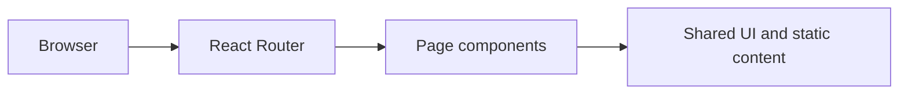

# Pattern Recognition Study Guide

A React and TypeScript educational website covering pattern recognition paradigms, classifiers, clustering, dimensionality reduction, and a practical assignment page.

## Stack

React 18, TypeScript, Vite, Tailwind CSS, and shadcn/ui components.

## Setup

Use Node.js 24 and npm (Node.js 22.13 or newer in the 22.x line is also supported).

```sh
git clone https://github.com/Arshad9999/pattern_recognition.git
cd pattern_recognition
npm ci
npm run dev
```

Open `http://localhost:8080`. The source currently requires no environment variables. Keep any future private credentials on a backend: values exposed through a client bundle are public.

## Checks

```sh
npm run build
npm run lint
npm test
```

`npm run preview` serves the production build locally. The `dist/` directory is the deployment output. A static host must serve `index.html` for client-side routes.

## Structure

- `src/pages/`: route-level pages.
- `src/components/`: application and shared UI components.
- `src/App.tsx`: providers and browser routes.
- `public/`: static files copied to the build.



## Provenance

This repository was scaffolded with Lovable. Its history includes generated-code commits; repository ownership alone does not establish which parts were independently implemented.

## License

No repository-wide license was detected. No new license has been assigned; the owner must choose appropriate terms and verify rights to included material.
